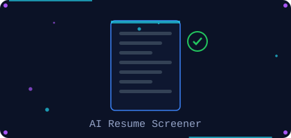
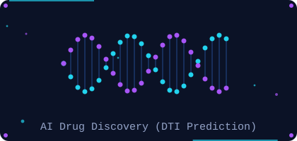
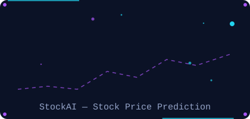
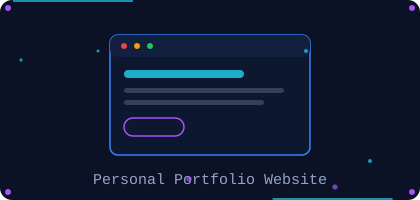
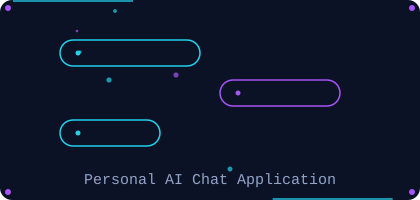
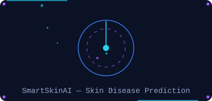
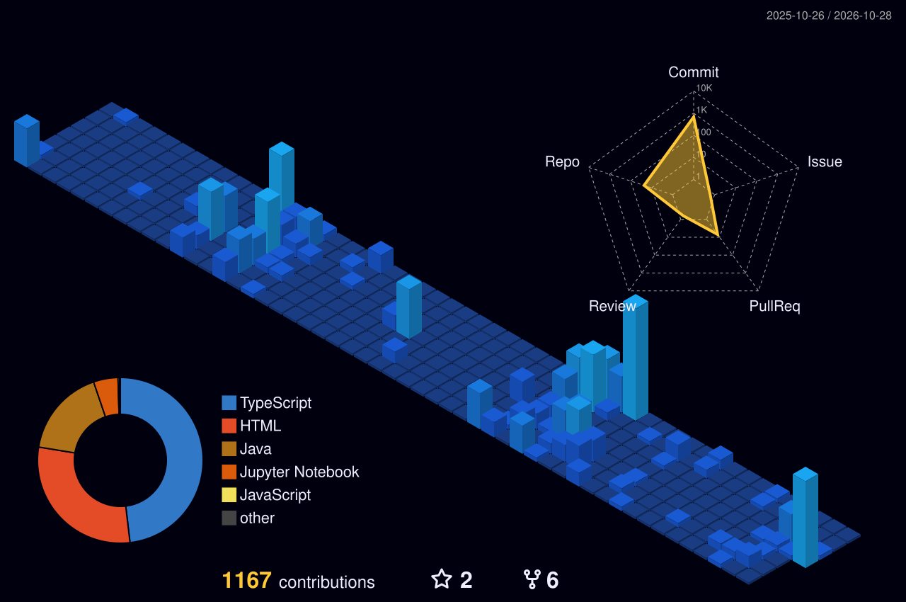

  

  
  
  
  
  
  

Passionate about building AI systems that create real impact. I enjoy working on Generative AI, LLMs, retrieval systems, computer vision and full stack applications.

- 🔭 Always learning new technologies
- 🚀 Building AI applications & intelligent agents
- 🤝 Open to collaborate on impactful projects
- ⚡ Fun fact: I love turning ideas into working products

**What I do:** `Generative AI` · `Machine Learning` · `Computer Vision` · `Full Stack Dev` · `Data & Analytics` · `Cloud & MLOps`

**AI / ML**

     

**Generative AI**

     

**Backend & APIs**

   

**Frontend**

   

**Data & Databases**

    

**DevOps & Tools**

    

| Project | Live Demo | Code |
|---|---|---|
| **AI Resume Screener** — Gemini-powered semantic resume screening | [Live](https://ai-resume-screener-xog4.onrender.com/) | [Repo](https://github.com/Varshith0105/AI-RESUME-SCREENER) |
| **AI Drug Discovery (DTI)** — CNN-based drug–target interaction prediction | [Live](https://drug-discovery-ai-cnn-based.vercel.app) | [Repo](https://github.com/Varshith0105/Drug_Discovery_AI_CNN-Based) |
| **StockAI** — AI stock price forecasting with interactive dashboards | [Live](https://stockpredectionai.vercel.app) | [Repo](https://github.com/Varshith0105/stock-predictor-pro) |
| **Personal AI Chat** — real-time context-aware AI chatbot | [Live](https://your-personal-ai-chat.vercel.app) | [Repo](https://github.com/Varshith0105/your-personal-ai-chat) |
| **SmartSkinAI** — skin disease prediction | [Live](https://smart-skin-ai.vercel.app) | [Repo](https://github.com/Varshith0105/SmartSkinAI) |
| **Portfolio Website** — modern responsive portfolio | [Live](https://varshith-portfolio-omega.vercel.app/) | [Repo](https://github.com/Varshith0105/Varshith-Portfolio) |

<a href="https://github.com/Varshith0105?tab=repositories">View all repositories →</a>

- ✅ **OCI 2025 Generative AI Professional** — Oracle
- ✅ **OCI 2025 AI Foundations Associate** — Oracle
- ✅ **AWS Certified Solutions Architect – Associate** — Amazon Web Services
- ✅ **ServiceNow Certified System Administrator** — ServiceNow
- ✅ **Software Engineering Job Simulation** — JPMorgan Chase & Co.
- ✅ **GenAI-Powered Data Analytics Job Simulation** — Tata Consultancy Services

  
  

  
  

  

<!-- Contribution Snake — requires the GitHub Action in SETUP.md to generate the snake SVG -->

  

  
  
  
  
  

## 🏙️ 3D Contribution City

  

  

 

  

