<!-- ═══════════════════════ HERO ═══════════════════════ -->
<a href="https://varshith-portfolio-omega.vercel.app/"></a>

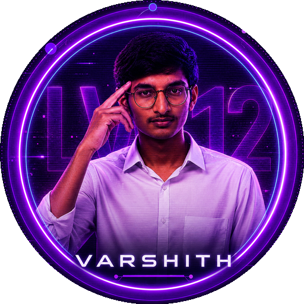

  
  
  
  

  

I’m **Varshith Julakanti**, a Computer Science student specializing in **Artificial Intelligence & Machine Learning** at VIT-AP. I enjoy building end-to-end products — from model experiments and data pipelines to APIs and polished interfaces.

- 🧠 Exploring **Generative AI, LLM applications, RAG, and AI agents**
- 🌾 Building practical AI projects for agriculture, healthcare, and productivity
- ⚙️ Working across **Python, Java, React, Next.js, FastAPI, and Spring Boot**
- 🤖 Interested in intelligent systems, robotics, and reliable AI engineering
- 🚀 Philosophy: **Build with curiosity. Validate carefully. Ship thoughtfully.**

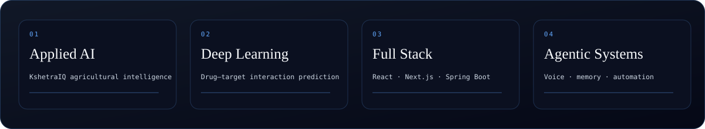


<table width="100%">
<tr>
<td width="50%" valign="top">
<a href="https://github.com/Varshith0105?tab=repositories"></a>

<strong>KshetraIQ</strong> AI-powered agricultural intelligence for crop recommendations, soil and weather context, model-backed predictions, and farmer-friendly reports. Python · FastAPI · Next.js · Machine Learning

</td>
<td width="50%" valign="top">
<a href="https://github.com/Varshith0105?tab=repositories"></a>

<strong>Drug Discovery AI</strong> Deep-learning project for drug–target interaction prediction, connecting model experimentation with a web interface. PyTorch · Deep Learning · React · TypeScript

</td>
</tr>
<tr>
<td width="50%" valign="top">
<a href="https://github.com/Varshith0105?tab=repositories"></a>

<strong>JARVIS / VORTEX</strong> Personal assistant concept exploring voice interaction, memory, and specialized agents for task-oriented workflows. Next.js · TypeScript · AI Agents

</td>
<td width="50%" valign="top">
<a href="https://github.com/Varshith0105/AI-RESUME-SCREENER"></a>

<strong>AI Resume Screener</strong> Resume and job-description matching to help compare candidate skills and experience. Java · Generative AI · Web <a href="https://github.com/Varshith0105/AI-RESUME-SCREENER">View repository ↗</a>

</td>
</tr>
</table>

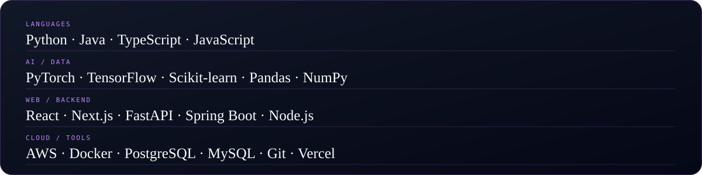

### Currently learning

<table width="100%">
<tr>
<td width="50%" valign="top">

**Generative AI & LLMs**
- Retrieval-Augmented Generation (RAG)
- Embeddings and semantic search
- Agentic workflows and tool use

</td>
<td width="50%" valign="top">

**AI Engineering**
- Production-ready ML APIs
- Model evaluation and deployment
- Full-stack system design
- Robotics and intelligent systems

</td>
</tr>
</table>


<h3 align="center">🏆 GitHub Trophies</h3>

  

<h3 align="center">📊 Stats & Languages</h3>

  
  

  

<h3 align="center">🐍 Contribution Snake</h3>

  <picture>
    <source media="(prefers-color-scheme: dark)" srcset="https://raw.githubusercontent.com/Varshith0105/Varshith0105/output/github-snake-dark.svg"/>
    <source media="(prefers-color-scheme: light)" srcset="https://raw.githubusercontent.com/Varshith0105/Varshith0105/output/github-snake.svg"/>
    
  </picture>

<h3 align="center">📈 Contribution Graph</h3>

  


  
  
  
  

Have an interesting AI idea, open-source project, or engineering problem? Let's connect.

  
  
  

