<!-- ═══════════════ BANNER ═══════════════ -->

  

<!-- ═══════════════ INTRO (Kiran-style: text left, avatar right) ═══════════════ -->

<h1>Hey, I'm Varshith 👋</h1>

**AI/ML Engineer in the Making &nbsp;|&nbsp; Generative AI &nbsp;|&nbsp; Agentic AI &nbsp;|&nbsp; Full-Stack Development**

I'm a Computer Science student specializing in **Artificial Intelligence & Machine Learning**. I build useful AI-powered systems end to end — from training deep-learning models to shipping them behind clean APIs and modern web apps.

- 🧠 Building **LLM applications**, semantic search and AI agents
- 🧬 Applying **deep learning** to real problems — drug–target interaction, skin-disease detection, stock forecasting
- ⚙️ Shipping **Spring Boot / REST** backends and **React / Next.js** frontends
- ☁️ Certified in **Oracle Cloud GenAI** and **AWS Solutions Architect – Associate**
- 🌐 More about me on my [**portfolio**](https://varshith-portfolio-omega.vercel.app/)

  
  
  
  

  

 

<!-- ═══════════════ TECH STACK + FOCUS ═══════════════ -->
<h2 align="center">⚡ Tᴇᴄʜ Sᴛᴀᴄᴋ & Cᴜʀʀᴇɴᴛ Fᴏᴄᴜs</h2>

<picture>
  <source media="(prefers-color-scheme: dark)" srcset="assets/anim/skills-dark.svg">
  <source media="(prefers-color-scheme: light)" srcset="assets/anim/skills-light.svg">
  
</picture>

<table width="100%">
<tr>
<td width="50%" valign="top">

### 🔭 What I'm Building
- **Semantic search** with fuzzy clustering & a semantic cache
- **AI agents** — working through a GenAI / Agentic AI course repo
- **AI Resume Screener** — Gemini-powered semantic matching

</td>
<td width="50%" valign="top">

### 🌱 Currently Exploring
- Retrieval-Augmented Generation & embeddings
- Agent frameworks with LangChain
- Deploying ML models as production APIs

</td>
</tr>
</table>

<!-- ═══════════════ PROJECTS ═══════════════ -->
<h2 align="center">🚀 Fᴇᴀᴛᴜʀᴇᴅ Pʀᴏᴊᴇᴄᴛs</h2>

<table width="100%">
<tr>
<td width="50%" valign="top" align="center">

<b>AI Resume Screener</b> — semantically matches multiple resumes against a job description using Google Gemini. Java · Gemini 
<a href="https://ai-resume-screener-xog4.onrender.com/">Live demo</a> · <a href="https://github.com/Varshith0105/AI-RESUME-SCREENER">Code</a>

</td>
<td width="50%" valign="top" align="center">

<b>AI Drug Discovery (DTI)</b> — CNN-based drug–target interaction prediction with a web interface. Deep Learning · TypeScript 
<a href="https://drug-discovery-ai-cnn-based.vercel.app">Live demo</a> · <a href="https://github.com/Varshith0105/Drug_Discovery_AI_CNN-Based">Code</a>

</td>
</tr>
<tr>
<td width="50%" valign="top" align="center">

<b>StockAI</b> — AI stock-price forecasting with interactive dashboards. Time-series ML · TypeScript 
<a href="https://stockpredectionai.vercel.app">Live demo</a> · <a href="https://github.com/Varshith0105/stock-predictor-pro">Code</a>

</td>
<td width="50%" valign="top" align="center">

<b>Personal AI Chat</b> — real-time, context-aware AI chatbot. LLMs · Python 
<a href="https://your-personal-ai-chat.vercel.app">Live demo</a> · <a href="https://github.com/Varshith0105/your-personal-ai-chat">Code</a>

</td>
</tr>
<tr>
<td width="50%" valign="top" align="center">

<b>SmartSkinAI</b> — skin-disease prediction from images. Computer Vision 
<a href="https://smart-skin-ai.vercel.app">Live demo</a> · <a href="https://github.com/Varshith0105/SmartSkinAI">Code</a>

</td>
<td width="50%" valign="top" align="center">

<b>Portfolio Website</b> — modern, responsive personal portfolio. React · TypeScript 
<a href="https://varshith-portfolio-omega.vercel.app/">Live demo</a> · <a href="https://github.com/Varshith0105/Varshith-Portfolio">Code</a>

</td>
</tr>
</table>

<!-- ═══════════════ CERTIFICATIONS ═══════════════ -->
<h2 align="center">🏅 Cᴇʀᴛɪғɪᴄᴀᴛɪᴏɴs</h2>

<table width="100%">
<tr>
<td width="50%" valign="top">

- **OCI 2025 Generative AI Professional** — Oracle
- **OCI 2025 AI Foundations Associate** — Oracle
- **AWS Certified Solutions Architect – Associate**

</td>
<td width="50%" valign="top">

- **ServiceNow Certified System Administrator**
- **Software Engineering Job Simulation** — JPMorgan Chase & Co.
- **GenAI-Powered Data Analytics Job Simulation** — TCS

</td>
</tr>
</table>

<!-- ═══════════════ GITHUB METRICS (lowlighter/metrics) ═══════════════ -->
<h2 align="center">📊 Gɪᴛʜᴜʙ Mᴇᴛʀɪᴄs</h2>

  
  

<table width="100%">
<tr>
<td width="50%" align="center"></td>
<td width="50%" align="center"></td>
</tr>
</table>

<!-- ═══════════════ CONTRIBUTIONS ═══════════════ -->
<h2 align="center">📈 Cᴏɴᴛʀɪʙᴜᴛɪᴏɴ Gʀᴀᴘʜ</h2>

  
  

<!-- ═══════════════ CONNECT ═══════════════ -->
<h2 align="center">🤝 Cᴏɴɴᴇᴄᴛ Wɪᴛʜ Mᴇ</h2>

  &nbsp;&nbsp;&nbsp;
  &nbsp;&nbsp;&nbsp;
  &nbsp;&nbsp;&nbsp;
  &nbsp;&nbsp;&nbsp;
  

  

